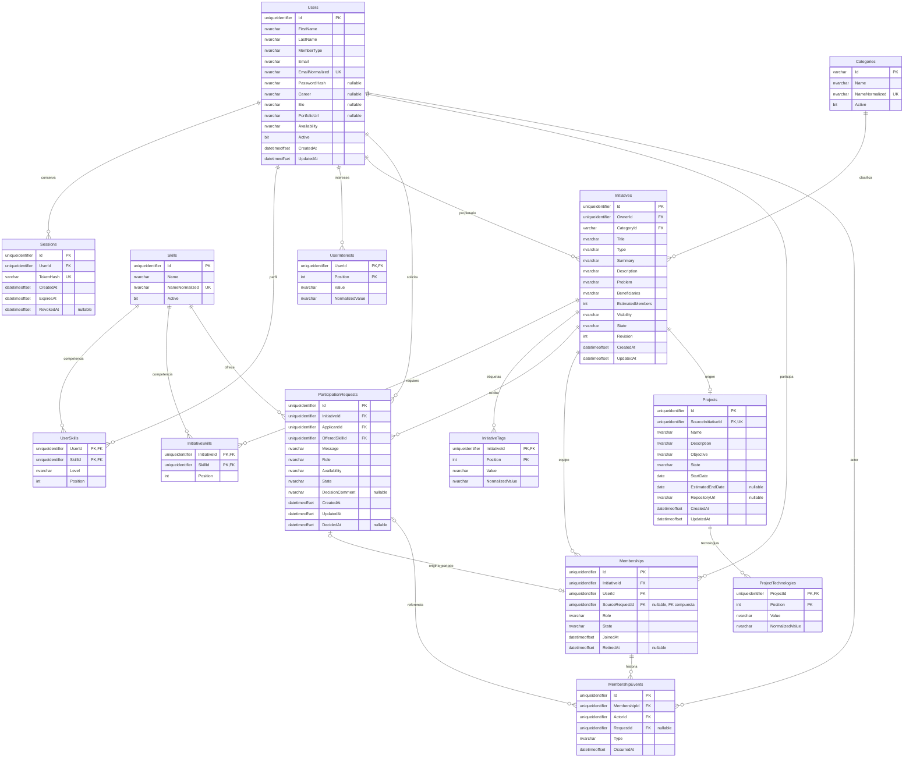

# Modelo de datos — Innovation Hub

Estado: diseño compartido de CO01. API02 implementó la conexión, las transacciones base y los catálogos; API03 implementa usuarios, credenciales y sesiones. Los módulos de dominio posteriores completan sus esquemas e índices. El contrato público continúa en [`api-contract.md`](api-contract.md); este documento describe persistencia, relaciones e integridad. Si ambos documentos difieren, se corrige la diferencia antes de implementar, no se crea un tercer contrato en Mongoose.

## Principios

- Cada entidad expuesta usa un `id` UUID único e inmutable. MongoDB puede conservar `_id` como clave interna, pero repositorios y DTO nunca lo devuelven.
- Las referencias persistidas usan UUID públicos (`userId`, `initiativeId`, etc.) para que los fixtures, Postman y la futura API .NET compartan identidad.
- Fechas persistidas son instantes UTC. Fechas de proyecto sin hora (`startDate`, `estimatedEndDate`) se conservan como texto `YYYY-MM-DD` y se validan como fecha calendario.
- `memberCount`, `availableSpaces` y `access` se calculan. Guardarlos duplicaría estado y permitiría inconsistencias.
- Las transiciones se realizan mediante filtros condicionales y, cuando afectan varias colecciones, dentro de una transacción de MongoDB en replica set.
- Los nombres normalizados solo sirven para índices/comparaciones. La forma presentada al usuario se conserva en su campo original.
- Los fixtures de CO01 no contienen contraseñas, hashes de contraseña, tokens ni hashes de token. API03 incorporará credenciales sintéticas mediante el seed de autenticación.

## Colecciones

### `users`

Campos principales:

| Campo | Tipo | Regla |
| --- | --- | --- |
| `id` | UUID string | Único e inmutable. |
| `firstName`, `lastName` | string | Recortados; límites del contrato. |
| `memberType` | enum | `student`, `professor`, `administrative`, `graduate`, `external`. |
| `email` | string | Forma presentada; nunca se devuelve a terceros. |
| `emailNormalized` | string | Minúsculas para unicidad. |
| `passwordHash` | string | Se agrega en API03; nunca aparece en fixtures/DTO. |
| `career`, `bio`, `portfolioUrl` | string o `null` | Opcionales. |
| `interests` | string[] | Embebido; máximo 15. |
| `skills` | `{skillId, level}[]` | Embebido porque pertenece al perfil y se actualiza junto. |
| `availability` | enum | `low`, `medium`, `high`. |
| `active` | boolean | Usuario inactivo no inicia sesión ni crea operaciones nuevas. |
| `createdAt`, `updatedAt` | date | UTC, administradas por servidor. |

Índices:

- único `{ id: 1 }`;
- único `{ emailNormalized: 1 }`;
- multikey `{ "skills.skillId": 1, lastName: 1, firstName: 1, id: 1 }` para directorio;
- `{ career: 1, availability: 1, id: 1 }` para filtros frecuentes.

No se embeben sesiones, iniciativas ni solicitudes en el usuario: tienen ciclo de vida y consultas independientes.

### `sessions`

`id`, `userId`, `tokenHash`, `expiresAt`, `revokedAt`, `createdAt` y metadatos técnicos mínimos. Solo se persiste el hash del token opaco. Índices únicos en `id` y `tokenHash`; TTL en `expiresAt`. Revocar actualiza condicionalmente una sesión vigente. El TTL limpia almacenamiento, no sustituye la comprobación de expiración/revocación.

### `categories` y `skills`

Catálogos separados para validar referencias y mantener IDs estables. Categorías usan slug contractual (`technology`, `education`, etc.); competencias usan UUID. Ambos guardan `name`, `nameNormalized` y `active`. Índices únicos en `id` y en `nameNormalized`. Desactivar conserva referencias históricas; no se elimina un catálogo utilizado.

### `initiatives`

Campos: `id`, `ownerId`, `title`, `type`, `summary`, `description`, `problem`, `beneficiaries`, `categoryId`, `skillIds`, `estimatedMembers`, `visibility`, `state`, `tags`, `createdAt`, `updatedAt`.

- `ownerId`, `categoryId` y cada `skillId` son referencias validadas.
- `skillIds` y `tags` se embeben porque son listas pequeñas editadas con la iniciativa.
- El propietario también tiene una membresía activa creada en la misma transacción.
- `published` es el estado inicial de este avance. `draft` solo permanece para compatibilidad y pruebas de acceso.
- `memberCount` se obtiene contando membresías activas.
- `availableSpaces = max(0, estimatedMembers - memberCount)`.
- Las capacidades de `access` se calculan según actor, propiedad, membresía, visibilidad y estado.

Índices:

- único `{ id: 1 }`;
- `{ ownerId: 1, state: 1, updatedAt: -1, id: 1 }` para `/initiatives/mine`;
- `{ state: 1, visibility: 1, createdAt: -1, id: 1 }` para catálogo;
- `{ categoryId: 1, state: 1, id: 1 }` y multikey `{ skillIds: 1, state: 1, id: 1 }`;
- índice de búsqueda acordado en API05 sobre campos normalizados o texto. La elección debe probar búsqueda sin distinguir mayúsculas/tildes; un índice de texto sin esa verificación no basta.

### `requests`

Campos: `id`, `initiativeId`, `applicantId`, `message`, `offeredSkillId`, `role`, `availability`, `state`, `decisionComment`, `createdAt`, `updatedAt`, `decidedAt`.

La solicitud conserva el intento completo. Un rechazo, cancelación o retiro posterior permite crear otra fila/documento con otro `id`; nunca se reabre ni sobrescribe el intento terminal.

Índices:

- único `{ id: 1 }`;
- único parcial `{ initiativeId: 1, applicantId: 1 }` con filtro `{ state: "pending" }`;
- `{ applicantId: 1, createdAt: -1, id: 1 }` para `scope=mine`;
- `{ initiativeId: 1, state: 1, createdAt: -1, id: 1 }` para solicitudes recibidas;
- `{ offeredSkillId: 1, state: 1, id: 1 }` para filtros.

La unicidad parcial protege carreras; una consulta previa solo mejora el mensaje. La aceptación/cancelación usa filtro `state=pending`, por lo que una sola transición puede ganar.

### `memberships`

Campos: `id`, `initiativeId`, `userId`, `role`, `state` (`active|retired`), `joinedAt`, `retiredAt`, `sourceRequestId` opcional.

Se crea una membresía nueva por cada periodo de participación. Retirarla no la elimina. Una reincorporación posterior crea otro `id`; el índice único parcial `{ initiativeId, userId }` filtrado por `state=active` impide dos membresías activas simultáneas y permite historia.

Índices adicionales: `{ initiativeId: 1, state: 1, joinedAt: 1, id: 1 }` y `{ userId: 1, state: 1, id: 1 }`.

### `membershipEvents`

Registro append-only con `id`, `initiativeId`, `userId`, `membershipId`, `type` (`joined|retired`), `occurredAt`, `actorId` y `requestId` opcional. Permite demostrar historia sin reconstruirla desde el último estado. Índices `{ initiativeId: 1, occurredAt: 1, id: 1 }` y `{ userId: 1, occurredAt: 1, id: 1 }`.

### `projects`

Campos: `id`, `sourceInitiativeId`, `ownerId`, `name`, `description`, `objective`, `technologies`, `startDate`, `estimatedEndDate`, `state`, `repositoryUrl`, `createdAt`, `updatedAt`.

`sourceInitiativeId` tiene índice único: una iniciativa solo produce un proyecto. El proyecto no copia integrantes; consulta las membresías activas de su iniciativa, incluso las aceptadas después de convertir. `technologies` se embebe porque es una lista pequeña propia del proyecto.

## Operaciones atómicas

| Operación | Escrituras o comprobaciones dentro de la transacción |
| --- | --- |
| Crear iniciativa | Insertar iniciativa `published`, membresía activa del propietario y evento `joined`. |
| Aceptar solicitud | Actualizar condicionalmente solicitud pendiente, verificar iniciativa no archivada, insertar membresía activa y evento. Si la iniciativa ya está `converted`, conservar ese estado. |
| Rechazar solicitud | Actualizar condicionalmente la solicitud pendiente; no crear membresía. Puede cerrar una pendiente de iniciativa archivada. |
| Cancelar solicitud | Actualizar condicionalmente la solicitud pendiente; se permite aunque la iniciativa esté archivada. |
| Retirar miembro | Cambiar membresía activa a retirada y agregar evento; impedir retirar propietario. |
| Convertir | Verificar propietario, estado y otro miembro activo; insertar proyecto único y cambiar iniciativa a `converted`. |
| Eliminar | Releer relaciones dentro de la transacción. Borrar iniciativa y membresía/evento automáticos solo sin historia adicional; con historia abortar con `409` sin cambios. |
| Archivar | Operación explícita independiente: actualizar a `archived` conservando todas las relaciones, incluso sin historia adicional. Repetición idempotente. |

Las pruebas de estas operaciones requieren replica set. Ejecutarlas contra MongoDB standalone y omitir la transacción sería una falsa aprobación.

## Estados e invariantes

- Solicitud: `pending -> accepted | rejected | cancelled`; los estados terminales no cambian.
- Membresía: se crea `active` y puede pasar a `retired`; una reincorporación crea otro documento.
- Iniciativa: este avance crea `published`; puede pasar a `forming_team`, `converted` o `archived` según servicio. Aceptar después de convertir no revierte `converted`.
- Proyecto: nace `planning`; los demás estados se conservan en el dominio, pero este avance no implementa su edición.
- El propietario nunca solicita ni se retira de su propia iniciativa.
- Una iniciativa puede superar `estimatedMembers`; la disponibilidad nunca es negativa.
- Una iniciativa físicamente eliminable solo conserva la relación automática del propietario y nunca tuvo solicitudes, miembros adicionales, eventos adicionales ni proyecto.

## Equivalente relacional para la API .NET

| MongoDB | Equivalente relacional |
| --- | --- |
| `users` | `Users`; `UserSkills`; `UserInterests`. |
| `categories`, `skills` | `Categories`, `Skills`. |
| `initiatives` | `Initiatives`; `InitiativeSkills`; `InitiativeTags`. |
| `requests` | `ParticipationRequests`; índice filtrado único para pendientes. |
| `memberships` | `Memberships`; índice filtrado único para activas. |
| `membershipEvents` | `MembershipEvents` append-only. |
| `projects` | `Projects` con `SourceInitiativeId` único; `ProjectTechnologies`. |
| `sessions` | `Sessions` con token hash único y proceso de expiración. |

Los DTO públicos no cambian al migrar: repositorios traducen documentos o filas a las mismas formas del contrato.

## Migración y fixtures

`pruebas/fixtures/legacy-mapping.json` registra las ocho iniciativas del Avance 1 y su traducción. Las categorías `Ambiente` y `Comunidad` se revisan por contenido: ambiente pasa a Sostenibilidad; accesibilidad y banco de alimentos pasan a Impacto social. Las visibilidades `comunidad` y `equipo` pasan a `institutional` y `private`. Los estados de los fixtures se diversifican deliberadamente para cubrir permisos, archivo, conversión y borrador; no se presentan como una migración histórica exacta.

Los archivos JSON son datos compartidos de mocks/seed, no volcados de MongoDB. El validador `node pruebas/fixtures/validate-fixtures.mjs` comprueba UUID, referencias, estados, cuatro visibilidades, propietario activo, una sola solicitud pendiente por pareja y un solo proyecto por iniciativa.

## Revisión cruzada requerida después de API02

- Confirmar que los índices parciales se expresan igual en Mongoose y en la inicialización de la base.
- Confirmar que el seed puede ejecutarse varias veces por `id` sin duplicar y que solo limpia la base de prueba indicada.
- Confirmar que las sesiones y hashes quedan fuera de los fixtures de dominio.
- Revisar la prueba real de rollback de API02 antes de implementar aceptación, retiro o conversión.
- Mantener `id` UUID en repositorios/DTO y evitar que `_id` se filtre al cliente.

## Modelo relacional

Estado: **T3B-03, modelo relacional completo**. Implementado en `servidor-net/Modelos`, `Datos/Configuraciones`, `CoreSeed.cs` y `DomainSeed.cs`, con dos migraciones reales: núcleo inicial y evolución a solicitudes/equipos/proyectos. Esta sección describe las 14 tablas implementadas; el apartado «Equivalente relacional» anterior era una propuesta del Avance 2. Las dos rutas GET corresponden al siguiente incremento T3B-04.

### Convenciones del núcleo

- Nombres SQL iguales a las entidades de referencia del contrato, en PascalCase. PK UUID en `uniqueidentifier`, sin generación automática; categorías conservan slug en `varchar(80)`. Los GET futuros serializarán UUID como texto, nunca como otra identidad.
- `N` en las tablas siguientes significa **NOT NULL**; `S`, nullable. Texto de usuario en `nvarchar`, longitudes en unidades UTF-16 como el contrato JavaScript. Los CHECK mínimos usan `DATALENGTH(LTRIM(RTRIM(...)))/2`; el tipo SQL impone el máximo. No se confunde número de glifos con unidades UTF-16.
- Instantes en `datetimeoffset(3)`, offset UTC cero comprobado por CHECK. Se conserva precisión de milisegundos; la serialización contractual con `Z` se añadirá en los GET. No se usan fechas locales ni valores aleatorios en HasData.
- Los valores fijos y las claves normalizadas usan collation **Latin1_General_100_BIN2**: `PUBLIC` no equivale a `public` y el índice compara exactamente la clave ya normalizada. No se depende de la collation predeterminada del servidor.
- `Position` empieza en cero y conserva el orden de los arrays del Avance 2. Su unicidad por propietario y su rango limitan el máximo de elementos sin contar filas desde un CHECK. No se exige continuidad en SQL; el futuro servicio ordenará/reindexará listas al escribir.
- Las normalizaciones deben calcularse en el servicio de escritura futuro y guardarse junto con el texto presentado. Intereses: minúsculas españolas conservando acentos. Etiquetas/catálogos: NFD, quitar diacríticos y minúsculas. Tecnologías: minúsculas conservando acentos, como valida Express. La siembra ya entrega esas claves. El CHECK de correo normalizado exige minúsculas del correo recortado; la validación completa de correo/URL/trim Unicode pertenece a la API final. No se afirma que un índice calcule la normalización por sí mismo.
- Las entidades intermedias tienen identidad compuesta, no un UUID artificial adicional. `UserSkill` conserva nivel y posición; `InitiativeSkill` conserva posición. EF configura también las navegaciones M:N mediante `UsingEntity`, sin crear tablas sombra ni copiar usuarios/competencias.

### Diagrama implementado

Las patas `o{` expresan el mínimo garantizado por las FK en SQL. En el dominio, una iniciativa necesita entre 1 y 10 competencias y un propietario miembro activo; el mínimo y la creación de membresía son reglas transaccionales entre filas. Memberships representa el equipo y la siembra incluye al propietario activo; no se inventa un CHECK que consulte otras tablas para garantizar ese mínimo en toda escritura.

### Diccionario de columnas, índices y CHECK

#### Users

| Columna | Tipo SQL | Null | Regla |
| --- | --- | --- | --- |
| Id | uniqueidentifier | N | PK; UUID público estable. |
| FirstName | nvarchar(60) | N | CHECK longitud recortada 2–60. |
| LastName | nvarchar(80) | N | CHECK longitud recortada 2–80. |
| MemberType | nvarchar(20) | N | CHECK student/professor/administrative/graduate/external. |
| Email | nvarchar(254) | N | CHECK longitud 3–254. |
| EmailNormalized | nvarchar(254) | N | Índice único; CHECK igualdad con LOWER del correo recortado, comparación binaria. |
| PasswordHash | nvarchar(512) | S | NULL en HasData; no hay contraseñas/autenticación en esta tarea. |
| Career | nvarchar(120) | S | CHECK NULL o longitud 2–120. |
| Bio | nvarchar(600) | S | CHECK NULL o longitud 1–600. |
| PortfolioUrl | nvarchar(2048) | S | CHECK NULL o longitud 1–2048; URL HTTP(S) se validará en servicio final. |
| Availability | nvarchar(6) | N | CHECK low/medium/high. |
| Active | bit | N | Estado del usuario. |
| CreatedAt, UpdatedAt | datetimeoffset(3), cada una | N | CHECK UTC y UpdatedAt ≥ CreatedAt. |

Unicidad: PK `Id`; `UX_Users_EmailNormalized`. Índice de consulta `(Career, Availability, Id)`. No hay campos skills/interests de texto: se representan en sus tablas propias.

#### Sessions

| Columna | Tipo SQL | Null | Regla |
| --- | --- | --- | --- |
| Id | uniqueidentifier | N | PK. |
| UserId | uniqueidentifier | N | FK Users.Id. |
| TokenHash | varchar(64) | N | Único, CHECK 64 caracteres hexadecimales minúsculos. Nunca token en claro. |
| CreatedAt, ExpiresAt | datetimeoffset(3), cada una | N | CHECK UTC y ExpiresAt > CreatedAt. |
| RevokedAt | datetimeoffset(3) | S | CHECK NULL o UTC y ≥ CreatedAt. |

Índices únicos: PK y `TokenHash`; ordinarios: `ExpiresAt`, `(UserId, CreatedAt)`. SQL Server **no convierte este índice de expiración en TTL**. La API final comprobará expiración/revocación en cada uso; la limpieza requerirá un proceso separado. No hay sesiones sembradas ni endpoints de autenticación en Tarea 3.

#### Categories

| Columna | Tipo SQL | Null | Regla |
| --- | --- | --- | --- |
| Id | varchar(80) | N | PK, CHECK slug 1–80 con a–z/0–9 y guiones internos, sin guiones dobles. |
| Name | nvarchar(80) | N | CHECK longitud 2–80. |
| NameNormalized | nvarchar(80) | N | Único, CHECK longitud 2–80. |
| Active | bit | N | Desactivar conserva referencias. |

Índices únicos: PK y `NameNormalized`.

#### Skills

| Columna | Tipo SQL | Null | Regla |
| --- | --- | --- | --- |
| Id | uniqueidentifier | N | PK, UUID contractual. |
| Name | nvarchar(80) | N | CHECK longitud 2–80. |
| NameNormalized | nvarchar(80) | N | Único, CHECK longitud 2–80. |
| Active | bit | N | Desactivar conserva referencias. |

Índices únicos: PK y `NameNormalized`.

#### UserSkills

| Columna | Tipo SQL | Null | Regla |
| --- | --- | --- | --- |
| UserId | uniqueidentifier | N | PK compuesta y FK Users.Id. |
| SkillId | uniqueidentifier | N | PK compuesta y FK Skills.Id. |
| Level | nvarchar(12) | N | CHECK basic/intermediate/advanced. Dato propio de la relación. |
| Position | int | N | CHECK 0–19; orden del array del perfil. |

Unicidad: PK `(UserId, SkillId)` impide repetir competencia; `(UserId, Position)` impide repetir posiciones y limita a 20 filas por usuario. Índice ordinario `(SkillId, UserId)` permite recorrer de competencia a usuarios.

#### UserInterests

| Columna | Tipo SQL | Null | Regla |
| --- | --- | --- | --- |
| UserId | uniqueidentifier | N | PK compuesta y FK Users.Id. |
| Position | int | N | PK compuesta; CHECK 0–14 (máximo 15). |
| Value | nvarchar(40) | N | Texto presentado; CHECK longitud 1–40. |
| NormalizedValue | nvarchar(40) | N | Minúsculas; CHECK longitud 1–40. |

Unicidad: PK `(UserId, Position)` y `(UserId, NormalizedValue)`. El interés es un valor del perfil, no un catálogo compartido; no hace falta una tabla global Interests.

#### Initiatives

| Columna | Tipo SQL | Null | Regla |
| --- | --- | --- | --- |
| Id | uniqueidentifier | N | PK. |
| OwnerId | uniqueidentifier | N | FK Users.Id. |
| CategoryId | varchar(80) | N | FK Categories.Id, misma collation binaria y longitud. |
| Title | nvarchar(100) | N | CHECK longitud 5–100. |
| Type | nvarchar(9) | N | CHECK idea/need/challenge. |
| Summary | nvarchar(240) | N | CHECK longitud 15–240. |
| Description | nvarchar(2000) | N | CHECK longitud 20–2000. |
| Problem | nvarchar(500) | N | CHECK longitud 10–500. |
| Beneficiaries | nvarchar(150) | N | CHECK longitud 3–150. |
| EstimatedMembers | int | N | CHECK 1–100; **estimación**, sin restricción contra el conteo de miembros. |
| Visibility | nvarchar(13) | N | CHECK public/institutional/restricted/private. |
| State | nvarchar(12) | N | CHECK draft/published/forming_team/converted/archived. |
| Revision | int | N | CHECK ≥0; token de concurrencia gestionado por la aplicación, no incremento automático. |
| CreatedAt, UpdatedAt | datetimeoffset(3), cada una | N | CHECK UTC y UpdatedAt ≥ CreatedAt. |

Unicidad: PK; título no es único. Índices de consulta: `(OwnerId, State, UpdatedAt, Id)`, `(State, Visibility, CreatedAt, Id)`, `(CategoryId, State, Id)`. No se almacenan `memberCount`, `availableSpaces` ni `access`: se calcularán desde el equipo y el actor al implementar GET.

#### InitiativeSkills

| Columna | Tipo SQL | Null | Regla |
| --- | --- | --- | --- |
| InitiativeId | uniqueidentifier | N | PK compuesta y FK Initiatives.Id. |
| SkillId | uniqueidentifier | N | PK compuesta y FK Skills.Id. |
| Position | int | N | CHECK 0–9; máximo 10 y orden del array. |

Unicidad: PK `(InitiativeId, SkillId)` y `(InitiativeId, Position)`. Índice ordinario `(SkillId, InitiativeId)`. El mínimo de una competencia requiere escritura transaccional; una FK no obliga al principal a tener hijos.

#### InitiativeTags

| Columna | Tipo SQL | Null | Regla |
| --- | --- | --- | --- |
| InitiativeId | uniqueidentifier | N | PK compuesta y FK Initiatives.Id. |
| Position | int | N | PK compuesta; CHECK 0–9. |
| Value | nvarchar(40) | N | Texto presentado; CHECK longitud 1–40. |
| NormalizedValue | nvarchar(40) | N | Sin diacríticos y minúsculas; CHECK longitud 1–40. |

Unicidad: PK `(InitiativeId, Position)` y `(InitiativeId, NormalizedValue)`. No se copian competencias en etiquetas: son conceptos distintos.

### Solicitudes, equipos, historial y proyectos (T3B-03)

Las siguientes tablas completan el modelo. Se agregan en la segunda migración `AgregarSolicitudesEquiposProyectos`; no sustituyen ni reescriben la migración inicial.

#### ParticipationRequests

| Columna | Tipo SQL | Null | Regla |
| --- | --- | --- | --- |
| Id | uniqueidentifier | N | PK; otro intento conserva otro ID. |
| InitiativeId | uniqueidentifier | N | FK Initiatives.Id. |
| ApplicantId | uniqueidentifier | N | FK Users.Id. |
| OfferedSkillId | uniqueidentifier | N | FK Skills.Id; no FK al perfil editable. |
| Message | nvarchar(500) | N | CHECK longitud 15–500. |
| Role | nvarchar(100) | N | CHECK longitud 3–100. |
| Availability | nvarchar(6) | N | CHECK low/medium/high. |
| State | nvarchar(9) | N | CHECK pending/accepted/rejected/cancelled. |
| DecisionComment | nvarchar(500) | S | CHECK NULL o longitud 1–500. |
| CreatedAt, UpdatedAt | datetimeoffset(3), cada una | N | CHECK UTC y UpdatedAt ≥ CreatedAt. |
| DecidedAt | datetimeoffset(3) | S | CHECK UTC, entre CreatedAt/UpdatedAt si existe. Requerida para accepted/rejected; NULL para pending/cancelled. |

Unicidad: PK `Id`; clave alternativa `(Id, InitiativeId, ApplicantId)` para que la FK de origen de membresía compruebe **solicitud, iniciativa y solicitante juntos**; `UX_Requests_Pending` único en `(InitiativeId, ApplicantId)` **WHERE State = N'pending'**. Los intentos cancelados/rechazados/aceptados no bloquean nuevas filas históricas.

Índices de consulta: `(ApplicantId, CreatedAt, Id)`, `(InitiativeId, State, CreatedAt, Id)`, `(OfferedSkillId, State, Id)`. La oferta debe pertenecer al perfil al solicitar, pero no necesariamente a las competencias requeridas por la iniciativa. Mantener la FK a Skills conserva historia aunque el usuario quite esa competencia de su perfil; comprobar pertenencia en el momento de solicitar corresponde al servicio final.

#### Memberships

| Columna | Tipo SQL | Null | Regla |
| --- | --- | --- | --- |
| Id | uniqueidentifier | N | PK del **periodo**, no de la pareja usuario/iniciativa. |
| InitiativeId | uniqueidentifier | N | FK Initiatives.Id; también integra FK de origen. |
| UserId | uniqueidentifier | N | FK Users.Id; también integra FK de origen. |
| SourceRequestId | uniqueidentifier | S | Con InitiativeId/UserId, FK a ParticipationRequests.(Id, InitiativeId, ApplicantId). NULL para propietario o incorporación histórica sin solicitud registrada. |
| Role | nvarchar(150) | N | CHECK longitud 2–150. |
| State | nvarchar(7) | N | CHECK active/retired. |
| JoinedAt | datetimeoffset(3) | N | CHECK UTC. |
| RetiredAt | datetimeoffset(3) | S | CHECK UTC y ≥ JoinedAt. NULL si active, obligatoria si retired. |

Unicidad: PK `Id`; `UX_Memberships_Active` en `(InitiativeId, UserId)` **WHERE State = N'active'**; índice único de origen `(SourceRequestId, InitiativeId, UserId)` filtrado por `SourceRequestId IS NOT NULL`. Una solicitud genera como máximo un periodo. La FK compuesta opcional admite varias membresías sin solicitud y rechaza vincular una solicitud de otra persona/iniciativa.

Índices de consulta: `(InitiativeId, State, JoinedAt, Id)`, `(UserId, State, Id)`. Resuelve usuario M:N iniciativa con datos propios (rol, estado, fechas, solicitud). Se permiten varias filas históricas de la misma pareja; no se usa una navegación M:N que confunda periodos repetidos con una sola asociación. Al reincorporarse se crea otro ID, no se reactiva el periodo retirado.

#### MembershipEvents

| Columna | Tipo SQL | Null | Regla |
| --- | --- | --- | --- |
| Id | uniqueidentifier | N | PK del evento. |
| MembershipId | uniqueidentifier | N | FK Memberships.Id. |
| ActorId | uniqueidentifier | N | FK Users.Id, quien produjo el evento. |
| RequestId | uniqueidentifier | S | FK ParticipationRequests.Id, referencia histórica opcional. |
| Type | nvarchar(7) | N | CHECK joined/retired. |
| OccurredAt | datetimeoffset(3) | N | CHECK UTC. |

Unicidad: PK e índice `(MembershipId, Type)` para un ingreso y como máximo un retiro por periodo. Índices de consulta: `(MembershipId, OccurredAt, Id)`, `(ActorId, OccurredAt, Id)`, `RequestId`.

`initiativeId` y `userId` de Mongo se obtienen mediante MembershipId: no se duplican columnas que pudieran apuntar a otra iniciativa/persona. RequestId se conserva porque es información propia del evento y puede ser NULL, independientemente del origen del periodo. La correspondencia semántica con el periodo y la cronología entre tablas se validarán en la escritura final. El esquema protege referencias; la regla de historial sin edición no equivale a permisos SQL ni a un trigger de append-only. En esta tarea solo hay siembra, verificación y lecturas.

#### Projects

| Columna | Tipo SQL | Null | Regla |
| --- | --- | --- | --- |
| Id | uniqueidentifier | N | PK. |
| SourceInitiativeId | uniqueidentifier | N | FK única Initiatives.Id. |
| Name | nvarchar(120) | N | CHECK longitud 5–120. |
| Description | nvarchar(2000) | N | CHECK longitud 20–2000. |
| Objective | nvarchar(500) | N | CHECK longitud 10–500. |
| State | nvarchar(14) | N | CHECK planning/in_development/paused/finished/archived. |
| StartDate | date | N | Fecha calendario real; obligatoria, como valida Express actualmente. |
| EstimatedEndDate | date | S | CHECK NULL o ≥ StartDate. |
| RepositoryUrl | nvarchar(2048) | S | CHECK NULL o longitud 1–2048; validación de URL HTTP(S) en servicio final. |
| CreatedAt, UpdatedAt | datetimeoffset(3), cada una | N | CHECK UTC y UpdatedAt ≥ CreatedAt. |

Unicidad: PK y `SourceInitiativeId` (una iniciativa origina como máximo un proyecto). Índice `(CreatedAt, Id)`. `ownerId` se obtiene de `SourceInitiative.OwnerId`; **no hay otra columna de dueño ni otro equipo copiado**. El equipo vigente se consulta por `SourceInitiative.Memberships WHERE State='active'`. Nuevas aceptaciones tras convertir afectan al equipo vinculado, sin duplicar escrituras en una tabla ProjectMembers.

#### ProjectTechnologies

| Columna | Tipo SQL | Null | Regla |
| --- | --- | --- | --- |
| ProjectId | uniqueidentifier | N | PK compuesta y FK Projects.Id. |
| Position | int | N | PK compuesta, CHECK 0–19: máximo 20 elementos. |
| Value | nvarchar(50) | N | Texto presentado, CHECK longitud 1–50. |
| NormalizedValue | nvarchar(50) | N | Minúsculas conservando acentos, CHECK longitud 1–50. |

Unicidad: PK `(ProjectId, Position)` y `(ProjectId, NormalizedValue)`. La lista conserva orden y rechaza claves normalizadas repetidas. El mínimo de una tecnología se valida transaccionalmente en el servicio final, no con un CHECK entre filas.

### Cardinalidades y comportamiento al borrar por FK

| FK dependiente → principal | Cardinalidad | DeleteBehavior | Justificación |
| --- | --- | --- | --- |
| Sessions.UserId → Users.Id | Usuario 1:N sesiones; sesión de un usuario | Restrict | No borrar historial de sesiones al eliminar perfil; desactivar/revocar. |
| UserSkills.UserId → Users.Id | Usuario 1:N vínculos | Cascade | Dato propio del perfil, sin ciclo de vida histórico independiente. |
| UserSkills.SkillId → Skills.Id | Competencia 1:N vínculos; conjunto resuelve usuario M:N competencia | Restrict | No eliminar una competencia que todavía usa un perfil. |
| UserInterests.UserId → Users.Id | Usuario 1:N valores | Cascade | Lista propia del perfil, no entidad histórica compartida. |
| Initiatives.OwnerId → Users.Id | Usuario 1:N iniciativas; iniciativa de un dueño | Restrict | No dejar iniciativas sin propietario ni borrarlas al eliminar usuario. |
| Initiatives.CategoryId → Categories.Id | Categoría 1:N iniciativas | Restrict | Desactivar catálogo conserva referencias. |
| InitiativeSkills.InitiativeId → Initiatives.Id | Iniciativa 1:N vínculos | Cascade | Se limpian solo los vínculos si la iniciativa puede borrarse según su historial. |
| InitiativeSkills.SkillId → Skills.Id | Competencia 1:N vínculos; conjunto resuelve iniciativa M:N competencia | Restrict | No eliminar competencia utilizada por una iniciativa. |
| InitiativeTags.InitiativeId → Initiatives.Id | Iniciativa 1:N etiquetas | Cascade | Valores propios sin historia independiente. |
| ParticipationRequests.InitiativeId → Initiatives.Id | Iniciativa 1:N solicitudes | Restrict | Conservar historia e impedir borrar la iniciativa de una solicitud. |
| ParticipationRequests.ApplicantId → Users.Id | Usuario 1:N solicitudes | Restrict | Conservar autoría histórica. |
| ParticipationRequests.OfferedSkillId → Skills.Id | Competencia 1:N ofertas | Restrict | Conservar referencia del catálogo aunque cambie el perfil. |
| Memberships.InitiativeId → Initiatives.Id | Iniciativa 1:N periodos | Restrict | No eliminar el equipo/historia por cascada. |
| Memberships.UserId → Users.Id | Usuario 1:N periodos | Restrict | No perder historial al eliminar usuario. |
| Memberships.(SourceRequestId, InitiativeId, UserId) → ParticipationRequests.(Id, InitiativeId, ApplicantId) | 0..1:0..1 por solicitud/periodo | Restrict | No borrar la solicitud que originó el periodo ni asociar otra persona/iniciativa. |
| MembershipEvents.MembershipId → Memberships.Id | Periodo 1:N eventos | Restrict | Impedir borrar un periodo con historia. |
| MembershipEvents.ActorId → Users.Id | Usuario 1:N eventos como actor | Restrict | Conservar quién realizó cada acción. |
| MembershipEvents.RequestId → ParticipationRequests.Id | Solicitud opcional 1:N eventos | Restrict | Conservar referencia histórica opcional; no hacer SetNull silencioso. |
| Projects.SourceInitiativeId → Initiatives.Id | Iniciativa 1:0..1 proyecto | Restrict | El proyecto exige su iniciativa; borrar/archivar no debe borrar proyecto. |
| ProjectTechnologies.ProjectId → Projects.Id | Proyecto 1:N valores | Cascade | Solo lista propia de tecnologías, sin historia independiente. |

`Restrict` se materializa como FK sin cascada (`NO ACTION`) en SQL Server; **ninguna FK del modelo usa SetNull**. No hay rutas múltiples de cascada hacia las mismas tablas porque las relaciones a usuarios/catálogos compartidos restringen el borrado. La cascada de listas **no autoriza** borrar una iniciativa con historia: las FK de historial/proyecto ya restringen el borrado y el servicio final deberá validar la política completa.

Usuario–iniciativa incluye **propiedad 1:N y participación M:N por periodos**. Proyecto–usuario se obtiene recorriendo la iniciativa y sus membresías; la tabla de cardinalidades requerida más abajo detalla las seis relaciones del enunciado, sin una lista duplicada de equipo.

### Del documento a la tabla

| Colección/campo del Avance 2 | Destino | Motivo y estado |
| --- | --- | --- |
| users, campos escalares | Users | Identidad estable; hash nullable por alcance sin autenticación. Implementado. |
| users.skills[] `{skillId,level}` | UserSkills + Skills | M:N real, nivel y orden propios de la asociación. Implementado. |
| users.interests[] | UserInterests | Lista de valores del perfil con orden, límite y clave normalizada única. Implementado. |
| sessions | Sessions | Sesiones independientes; índice de expiración sin TTL automático. Implementado, sin seed. |
| categories | Categories | Slug contractual, nombre y normalización únicos. Implementado. |
| skills | Skills | Competencias compartidas, no duplicadas en cada perfil/iniciativa. Implementado. |
| initiatives, escalares y ownerId/categoryId | Initiatives | FK reales; Revision conserva control de concurrencia futuro. Implementado. |
| initiatives.skillIds[] | InitiativeSkills | M:N real con orden; sin array JSON ni columnas numeradas. Implementado. |
| initiatives.tags[] | InitiativeTags | Valores propios, unicidad normalizada y orden. Implementado. |
| initiatives.searchText/publicSearchText/titleNormalized | Sin columnas en esta fase | Índices/derivados de búsqueda Mongo, no datos de dominio. Las dos lecturas elegidas no buscan por texto; estrategia SQL de búsqueda/orden se definirá para la API final sin cambiar DTO. |
| requests | ParticipationRequests | Ciclo propio, historia e índice único filtrado de pendientes. Implementado. |
| memberships | Memberships | Cada periodo es una fila nueva, unicidad filtrada de activos y origen comprobado con FK compuesta. Implementado. |
| membershipEvents | MembershipEvents | Historia con actor, periodo y solicitud opcional, referencias protegidas. Implementado. |
| membershipEvents.initiativeId/userId | Derivados de Memberships | Se obtienen desde MembershipId, sin duplicar referencias que pudieran contradecir el periodo. |
| projects, campos escalares | Projects | Una iniciativa de origen por proyecto y vínculo único; fecha de inicio obligatoria como Express. Implementado. |
| projects.ownerId | Derivado de Initiatives.OwnerId | Dueño único a través de SourceInitiativeId; no crear dos propietarios independientes. |
| projects.technologies[] | ProjectTechnologies | Lista ordenada, con clave normalizada única y máximo 20; sin JSON. Implementado. |
| Equipo de projects | Sin segunda lista copiada | Recorrido Projects → Initiatives → Memberships → Users; miembros activos o historia según la consulta. Implementado. |
| Mongo _id, __v y TTL | Sin identidad ni mecanismo equivalentes expuestos | UUID público es PK; __v no integra contrato; expiración SQL requiere proceso, no un índice TTL. |

### HasData del núcleo y su evolución

`Datos/CoreSeed.cs` contiene datos sintéticos estáticos copiados de `pruebas/fixtures`: **5 usuarios, 8 categorías, 10 competencias, 8 iniciativas, 7 UserSkills, 7 UserInterests, 16 InitiativeSkills y 13 InitiativeTags; 0 sesiones**. Total: 74 filas de dominio. No lee los JSON en ejecución, no depende de rutas de trabajo, no genera fechas/IDs aleatorios y no incluye contraseñas ni hashes.

Las iniciativas cubren las cuatro visibilidades y estados públicos/de equipo/borrador/archivo/convertido. La primera migración dejó esos vínculos para la evolución siguiente. DomainSeed y la segunda migración agregan ahora proyecto, membresías, solicitudes y eventos; la iniciativa convertida comparte un equipo de tres activos y conserva un periodo retirado.

El modo de terminal `--verify-core=true` comprueba semilla, M:N, nivel/orden, rechazos por restricciones, UTF-16 y cascada limitada. Solo admite bases exclusivas `InnovationHub_Tarea3_Dev` o `InnovationHub_Tarea3_Test`; cada escritura se revierte. Esta verificación no sustituye las cuatro consultas SQL de Francisco (T3B-06), que siguen pendientes.

Referencias de implementación: [relaciones M:N y datos de asociación](https://learn.microsoft.com/ef/core/modeling/relationships/many-to-many), [índices y CHECK](https://learn.microsoft.com/ef/core/modeling/indexes), [HasData](https://learn.microsoft.com/ef/core/modeling/data-seeding). La consigna exige HasData aunque la documentación también presente otras opciones de siembra.

### Relaciones requeridas y reglas entre filas

| Relación requerida | Cardinalidad y resolución |
| --- | --- |
| Usuario–competencia | M:N mediante UserSkills con nivel y posición. |
| Usuario–iniciativa (propiedad) | Usuario 1:N Initiatives, FK OwnerId; cada iniciativa tiene un dueño. |
| Usuario–iniciativa (participación) | M:N mediante Memberships, una fila por periodo; índice filtrado garantiza una activa por pareja. |
| Iniciativa–competencia | M:N mediante InitiativeSkills, posición propia. |
| Iniciativa–solicitud | 1:N mediante ParticipationRequests.InitiativeId. |
| Proyecto–iniciativa | Cada proyecto tiene exactamente una iniciativa; cada iniciativa tiene 0..1 proyecto, FK única SourceInitiativeId. |
| Proyecto–usuario (dueño) | Usuario 1:N proyectos por Projects → Initiatives.OwnerId; dueño derivado, sin columna redundante. |
| Proyecto–usuario (equipo) | M:N derivada por Projects → Initiatives → Memberships → Users; activo/histórico se distingue por periodo y estado. No se crea un segundo equipo. |

No se introduce un cupo duro: EstimatedMembers sigue en 1–100, pero no se compara contra el número de miembros. La siembra incluye una iniciativa convertida con estimado 2 y tres activos: es válida y la disponibilidad calculada es cero.

Las FK/índices/CHECK garantizan referencias, unicidad filtrada y coherencia de cada fila. La API final requerirá transacciones para aceptar/cancelar, comprobar permisos, no solicitar siendo miembro activo o propietario, impedir retiro del dueño, validar competencia ofrecida en el momento de solicitar, convertir solo si corresponde, escribir eventos y conservar converted al aceptar después. No se afirma que los CHECK implementen por sí solos esas operaciones o transiciones.

La política de borrado se conserva: eliminar físicamente solo si nunca hubo relaciones adicionales al dueño. Las FK evitan eliminar de forma aislada iniciativas o periodos con relaciones. En el caso eliminable, el servicio deberá comprobar toda la historia y retirar explícitamente el único evento/membresía inicial del dueño en una misma transacción antes de borrar la iniciativa; las listas propias se limpian por Cascade. Las demás iniciativas se archivan mediante una acción independiente. No hay todavía endpoints .NET de escritura/borrado.

### Migraciones y comprobación final del modelo

- Etapa 1: `InicialUsuariosIniciativas`, nueve tablas del núcleo y 74 filas de dominio.
- Etapa 2: `AgregarSolicitudesEquiposProyectos`, cinco tablas nuevas, FK/restricciones e inserción HasData de 5 solicitudes, 12 periodos de membresía, 13 eventos, 1 proyecto y 2 tecnologías.
- Modelo completo: **14 tablas de dominio y 107 filas sintéticas** (más __EFMigrationsHistory). Hay 11 membresías activas y una retirada; el proyecto usa tres activos y conserva un periodo retirado.
- `--verify-domain=true` ejecuta las comprobaciones del núcleo y las del dominio completo con rollback; prueba duplicados, reincorporación con otro ID, historia, equipo después de conversión y fechas calendario.
- `--use-test-database=true` selecciona solo InnovationHub_Tarea3_Test en Development sin cambiar el secreto de Dev; permite aplicar ambas migraciones a una base de prueba independiente.
- `--compare-databases=true` compara columnas, nulabilidad, FK/borrado, CHECK, índices, valores completos de las 14 tablas e historial entre Dev actualizado y Test construido desde cero. No crea ni elimina bases, no imprime datos o secretos; los dos destinos deben contener la misma siembra sin cambios de usuario.

El modo de comparación no sustituye la reconstrucción destructiva `drop --force` + `update` de T3B-05. No se ha adelantado la entrega SQL ni la investigación de Francisco.

Referencias para esta etapa: [claves principales/alternativas y FK compuestas](https://learn.microsoft.com/ef/core/modeling/relationships/foreign-and-principal-keys), [índices únicos y filtrados](https://learn.microsoft.com/ef/core/modeling/indexes). Los resultados de pruebas ejecutadas y pendientes se registran en el [plan de Tarea 3](tarea3-parte-b.md).
